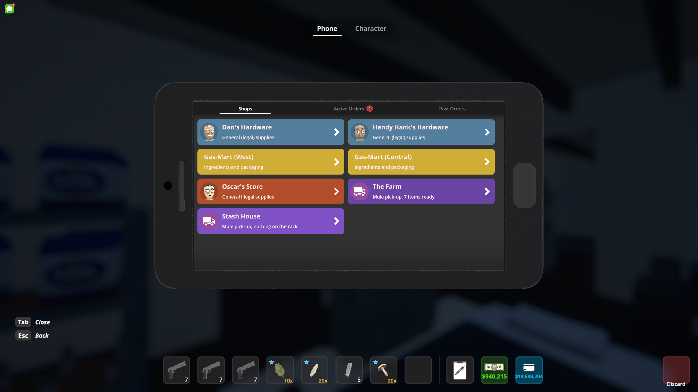
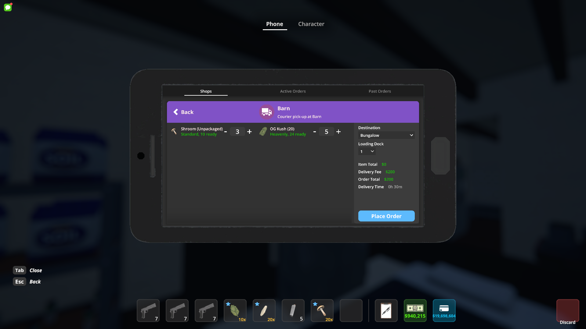
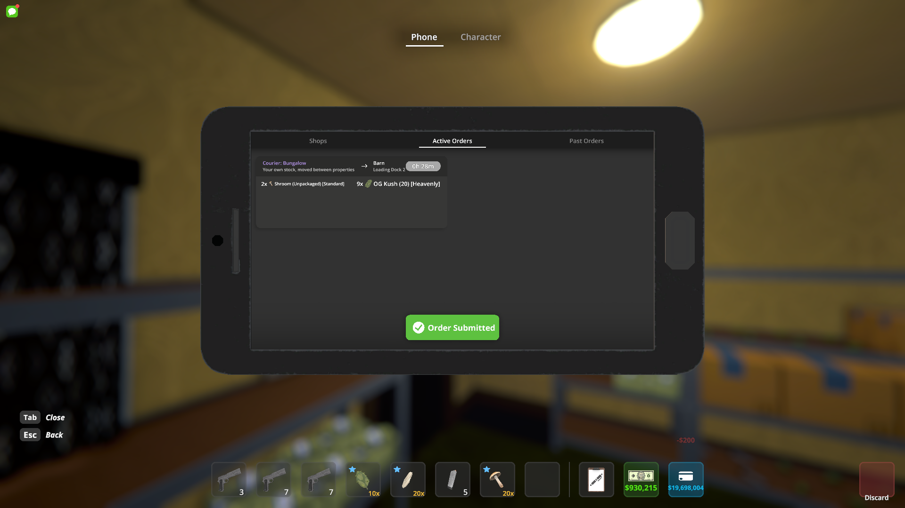
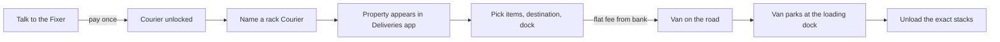
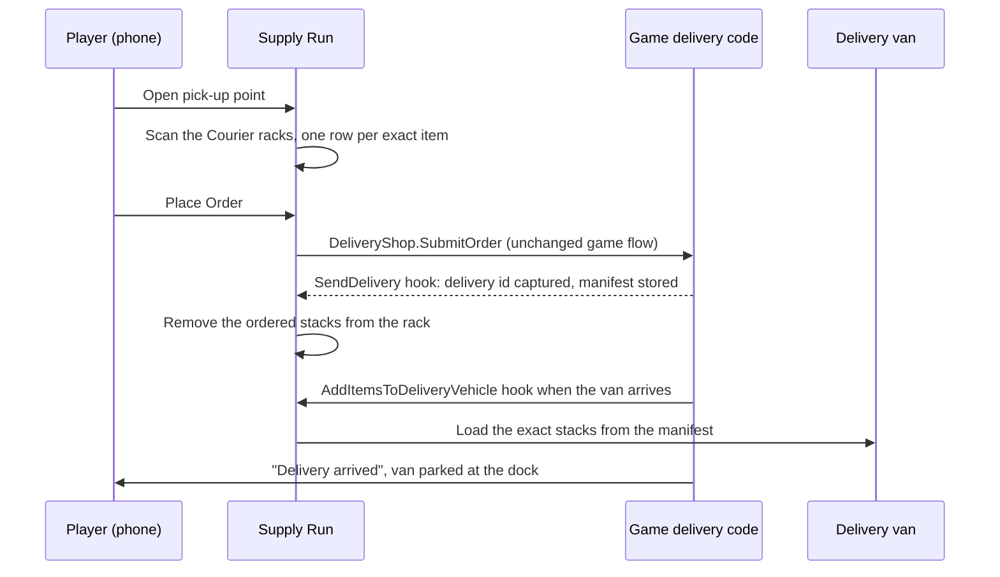
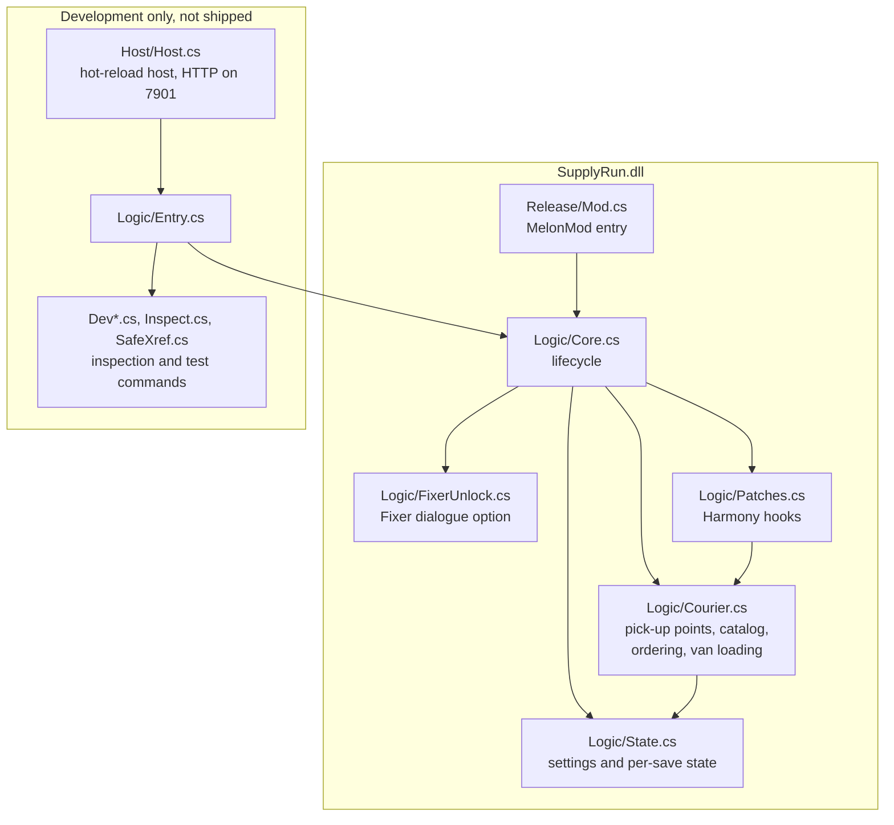

# Supply Run

A courier mod for [Schedule I](https://store.steampowered.com/app/3164500/Schedule_I/). Buy a courier from the Fixer, name a storage rack "Courier", and ship your own stock between your properties with the game's delivery van.

Built for the default (IL2CPP) branch of the game with MelonLoader, so it works alongside multiplayer with friends on the standard build.

| Pick-up points | Order page | Active orders |
|---|---|---|
|  |  |  |

## What it does

- The **Fixer** (the contact who hires your employees) sells the courier service once per save. Default price: $5,000 cash.
- Every property you own that has storage named **Courier** becomes a pick-up point in the phone's **Deliveries** app.
- The pick-up point's catalog is whatever is on that rack right now. It is rebuilt every time you open it.
- Ordering ships those exact stacks to another property with a loading dock. Bricks stay bricks, quality is kept, a gun keeps its ammo count, and anything past one stack spills into the next van slot.
- The cargo is free because you already own it. You pay a flat delivery fee (default $200) from the bank.
- Your own handlers can unload the van like any other delivery.

## How to use it in game

1. Talk to the Fixer and pick "I need a courier to move product between my properties".
2. With the management clipboard, rename any storage rack so its name contains `Courier` (for example `Courier` or `Courier overflow`).
3. Open the Deliveries app. The property shows up as a purple card.
4. Open the card, pick quantities, a destination and a loading dock, then Place Order.
5. Unload the van at the destination dock.



## Install

1. Install [MelonLoader](https://melonwiki.xyz/) 0.7.x into Schedule I and start the game once so it generates its assemblies.
2. Build the mod (see below) or take a built `SupplyRun.dll`.
3. Copy `SupplyRun.dll` into `Schedule I\Mods\`.
4. Start the game. The MelonLoader console prints `Supply Run courier ready.`

The game must be fully quit before you replace a mod DLL.

## Settings

Settings live in `Schedule I\UserData\MelonPreferences.cfg` under `[SupplyRun]`. They are created the first time the game runs with the mod.

| Setting | Default | Meaning |
|---|---|---|
| `UnlockPrice` | `5000` | One-time cash price the Fixer charges. |
| `DeliveryFee` | `200` | Flat fee per run, paid from the bank balance. |
| `CourierRackName` | `Courier` | Storage whose name contains this text is a pick-up point. |
| `RequireCourierRack` | `true` | `false` offers every storage unit in the property instead of only named ones. |
| `RequireFixerUnlock` | `true` | `false` makes the courier available without buying it. |
| `ServiceName` | `Courier` | What the service is called in the Deliveries app. |
| `ShopNames` | empty | Custom pick-up point names, `propertycode=Name` pairs separated by semicolons. Example: `bungalow=Stash House;barn=The Farm` |
| `AccentColor` | `#8052C7` | Colour of courier entries in the Deliveries app. |

## How it works

The mod does not add a new delivery system. It feeds the game's own one.



Key points:

- **Pick-up points are cloned shop pages.** Each one is a copy of a vanilla delivery shop page and card, re-labelled, with its own rows.
- **A row is one exact item.** Two stacks share a row only if their saved item data is identical once the quantity is ignored. That is what keeps packaging, quality, clothing colour, ammo and fill levels intact.
- **The van is borrowed.** Each vanilla delivery shop owns one van. A courier run uses the van of a shop that has nothing on the road, preferring shops you have not unlocked. The delivery is recorded under that shop's name so the save file stays a normal, loadable save.
- **The game normally loads a van by item id**, which is why a plain delivery cannot carry packaged product. The mod replaces that step for courier runs and loads the stored manifest instead.
- **State travels with the save.** The unlock and the manifests of runs on the road are written when the game finishes saving, into `SupplyRun.json` inside the save folder, with a copy under `UserData\SupplyRun\` as a fallback. The game ignores the extra file when loading.



## Known limits

- **Host only.** In multiplayer only the host can book courier runs. Clients see the delivery in their Active Orders under the borrowed shop's name.
- **It borrows a shop's van.** While a courier run uses a shop's van, that shop cannot deliver until the van has been emptied. If every van is out, the order button says so.
- **Do not remove the mod with a run on the road.** Without the mod the game loads that van by item id, so the cargo arrives as plain, unpackaged items.
- **A rack that a player has open cannot be shipped from** until it is closed.
- Tested on game version 0.4.7f12. Co-op with a second player and a physical controller were exercised through the game's own code paths, not by hand.

## Build

Requirements: .NET SDK 6 or newer, Schedule I with MelonLoader installed and started once.

```
cd Release
dotnet build -c Release
```

The DLL lands in `Release\bin\SupplyRun.dll`. The project files reference the game's assemblies from `C:\Program Files (x86)\Steam\steamapps\common\Schedule I`; change `GamePath` in the `.csproj` files if your game is installed elsewhere.

## Development setup

`Host/` builds a small MelonLoader mod that hot-reloads the logic assembly, so most changes do not need a game restart. It also serves an HTTP inspector on `http://localhost:7901` used to drive and inspect the game from scripts.

- `dev.sh` builds `Logic/` and tells the host to reload it. `dev.sh tools` builds only the inspection and test commands, for use next to the release DLL.
- `launch.sh [slot]` starts the game and loads a save slot.
- `Host/Host.cs` has the path to the logic DLL as a constant (`LogicPath`); adjust it to where you cloned the repo.

The inspector can load code and call into the game, so it only answers requests that carry a per-session secret in an `X-Dev-Token` header. The host writes that secret to `Schedule I\UserData\SupplyRunDev.token` on startup and the scripts read it from there (set `SCHEDULE1_DIR` if the game is not in the default Steam folder). Requests with a browser `Origin` header or the wrong `Host` are refused. Install the dev host only while developing.

Do not install the dev host and the release DLL with a full logic build at the same time, the feature would run twice.

## Related mods

- [schedule1-fixed-cash-drops](https://github.com/purplehaxttv/schedule1-fixed-cash-drops): bigger payouts from broken ATMs, Cuke machines and trash recyclers.
- [schedule1-chat-fx](https://github.com/purplehaxttv/schedule1-chat-fx): lets Firebot chat commands and redeems trigger effects in the game.
